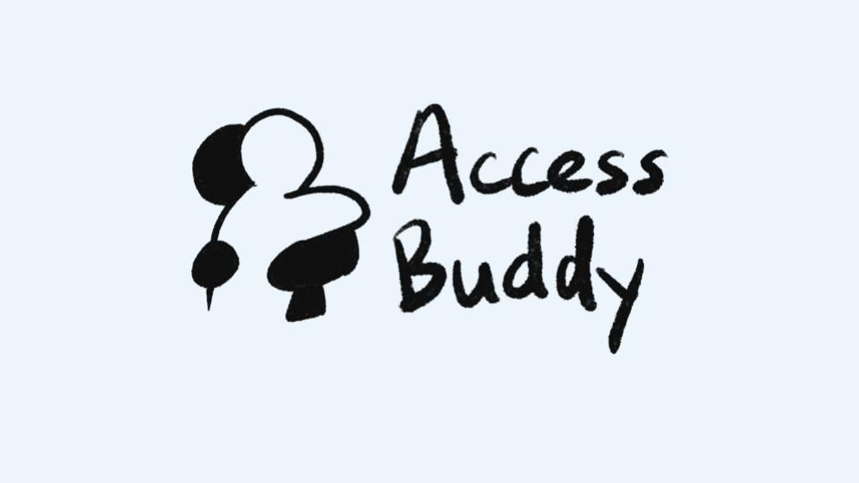
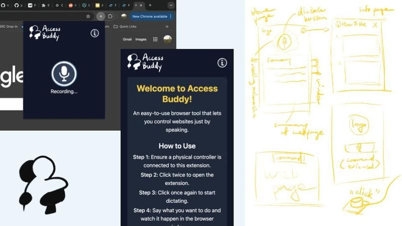

An accessibility-focused Chrome extension that lets people with physical impairments navigate the web using only their voice. It won nwHacks 2025.

<mark>The goal was to make every click something you can say.</mark>

