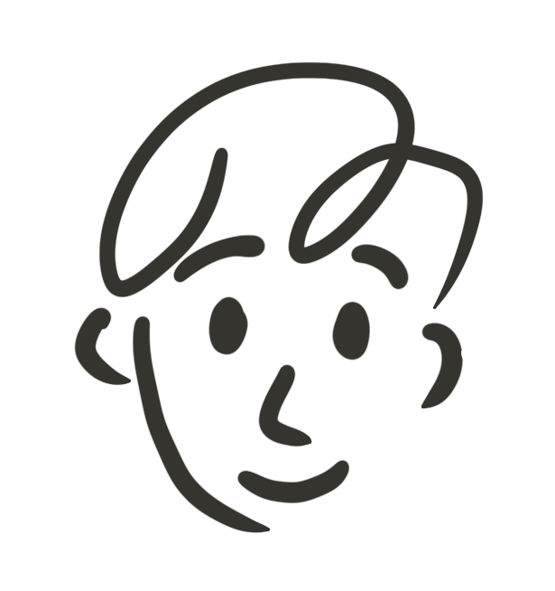
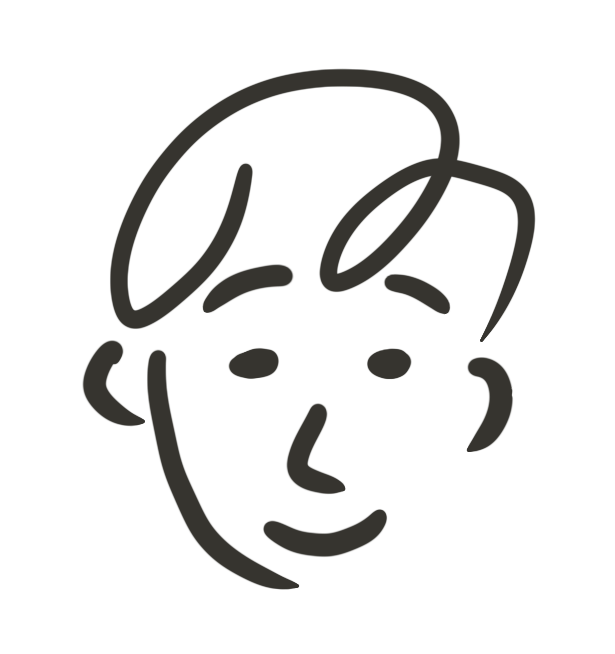
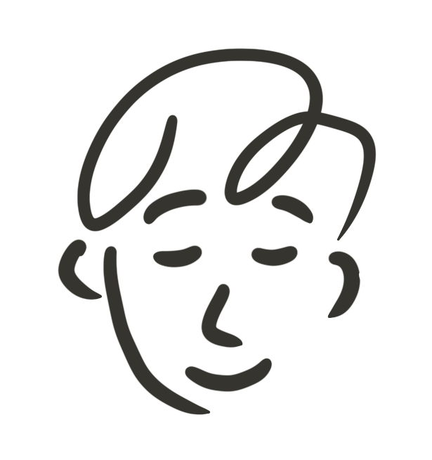

How the little guy in the top left got made: 40 sketches, three frames, one blink.

The blink is three drawings: eyes open, half shut, and closed. They swap instantly, because a cross-fade looks like a ghost, not an eyelid.

<small>open, half, closed. hover him in the corner to see it.</small>
