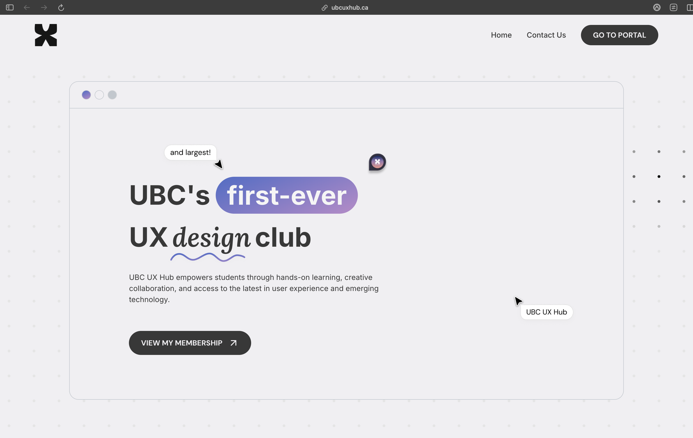

The portal is where UBC UX Hub runs its year: members buy a membership, apply to events, and check in at the door with a QR code.

Applications are reviewed together, so the decision doesn't live in someone's DMs. <mark>A student club's tools should be good enough that nobody needs a spreadsheet.</mark>

More to come.
