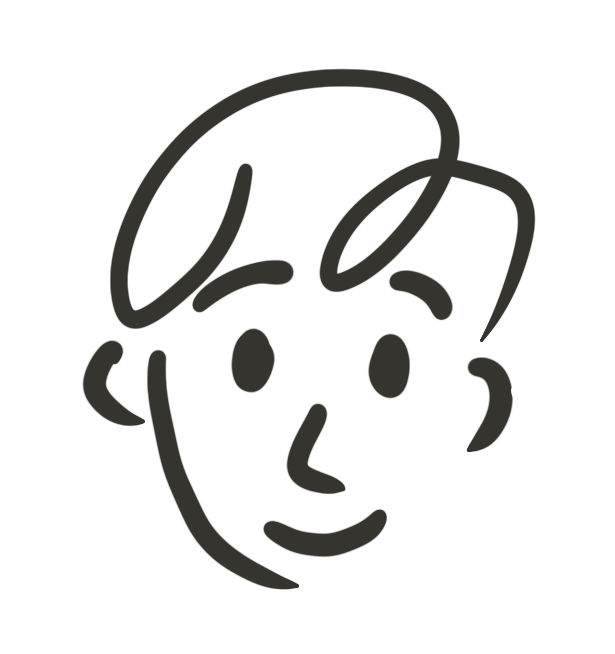
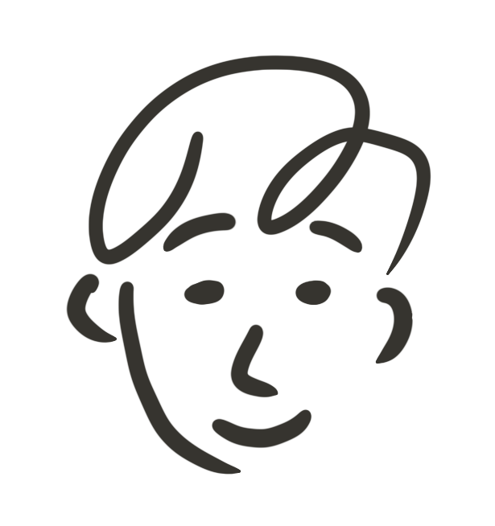
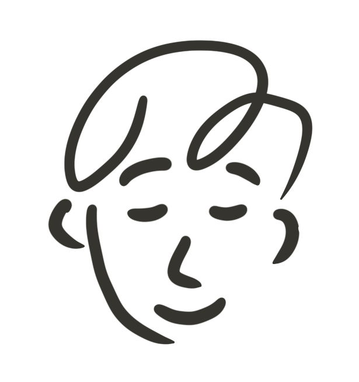

I drew the little face on the top left in Procreate.

The blink is three drawings: eyes open, half shut, and closed. The transition frame plays as the eye opens. This is because open takes longer than closing in a real blink.

<small>open, half, closed. hover him in the corner to see it.</small>
