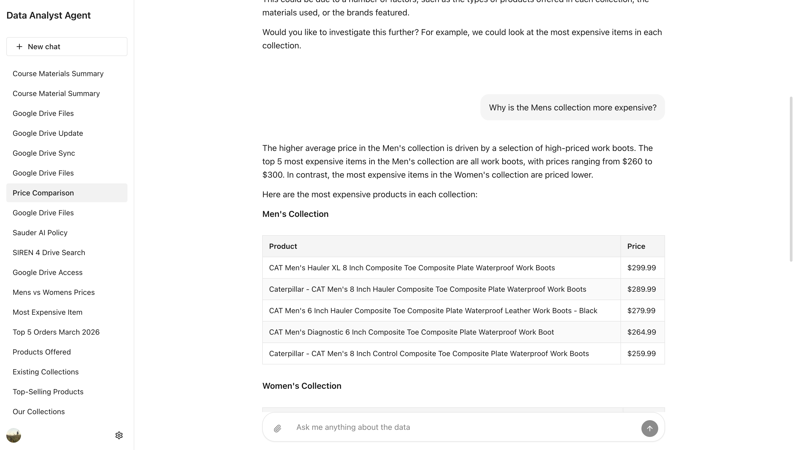
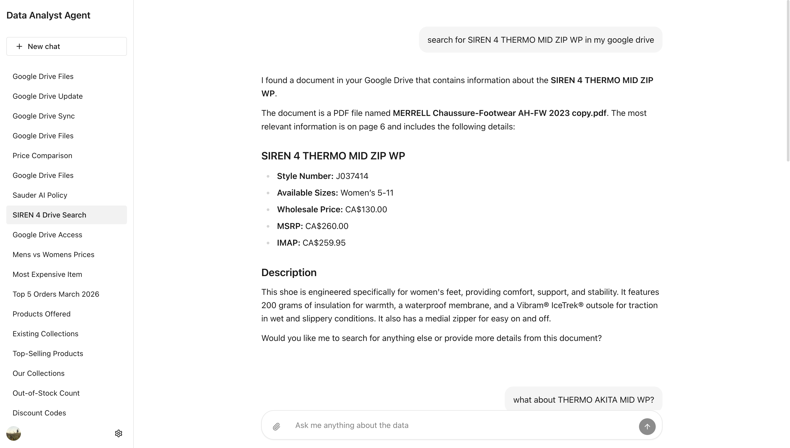
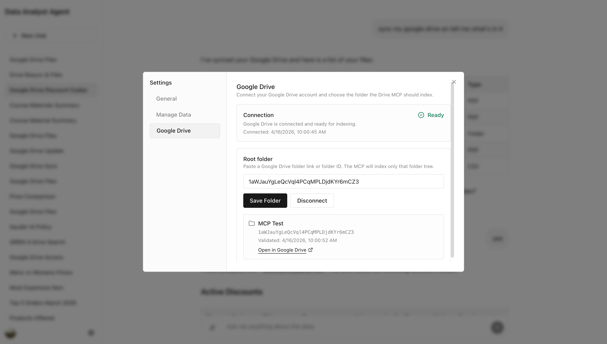
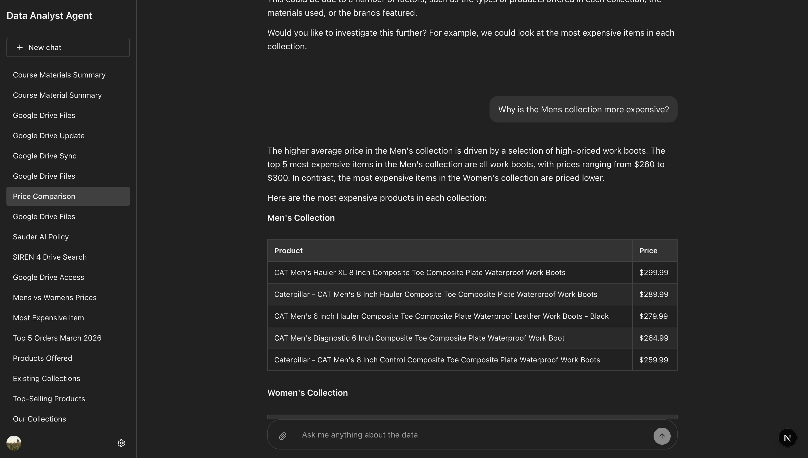

An agent and its MCP servers, built from scratch with ADK and Next.js. You ask a question about a store's data in plain language, and the agent works out which tools to call.

Replies stream in over SSE, so you watch the agent work instead of waiting on a spinner. The sidebar keeps multiple sessions, so a long investigation doesn't get lost when you start a new question.

==The hard part wasn't the model, it was deciding what the tools should be.== You can also upload a file and ask about that instead.

