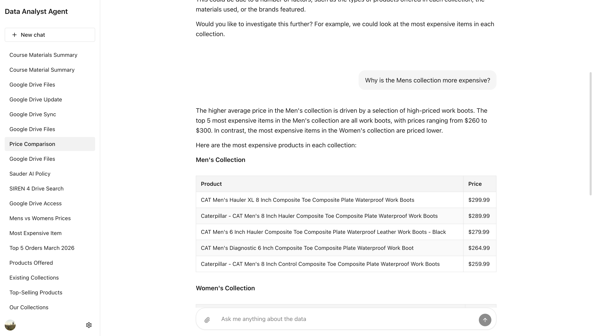
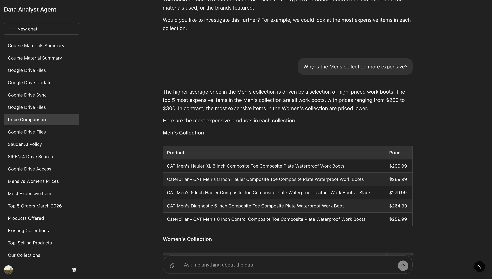

This is a project I lead during my internship at Customer Maps. An enterprise search prototype for small e-commerce businesses.

An agent and its MCP servers, built from scratch with ADK and Next.js. You ask a question about a store's data in plain language and gets back and gets back a tailored product catalog with real prices.

Replies stream in over SSE, so you watch the agent work. It supports multiple sessions running simultaneously.

==The hard part wasn't the agent, it was aggregating and filtering the right data for the agent.==

We built custom MCP Servers so users can connect (OAuth) their data sources. Written in python with FastMCP.

- Shopify MCP
- Google Analytics MCP
- Google Drive MCP

The Google Drive MCP indexes and searches PDFs. So any query returns with the exact quote with page reference.

dark mode

