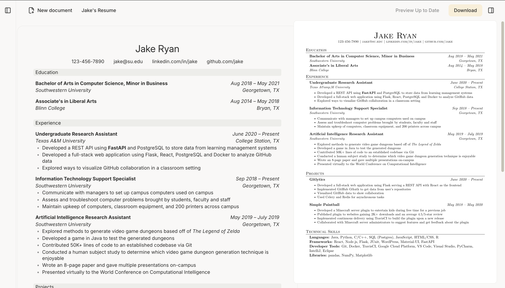

<small>ask for documents and they land on your desk, a click apart.</small>

Pepper Docs is a TipTap based semi structured Rich-Text editor for PDF documents.

<small>drag a whole entry, or a whole section, and the PDF reflows.</small>

more info to come!

<small>side by side: what you type, and what the recruiter gets.</small>

<small>content, editor structure and style are three separate files, and the PDF tells the editor how to look.</small>
