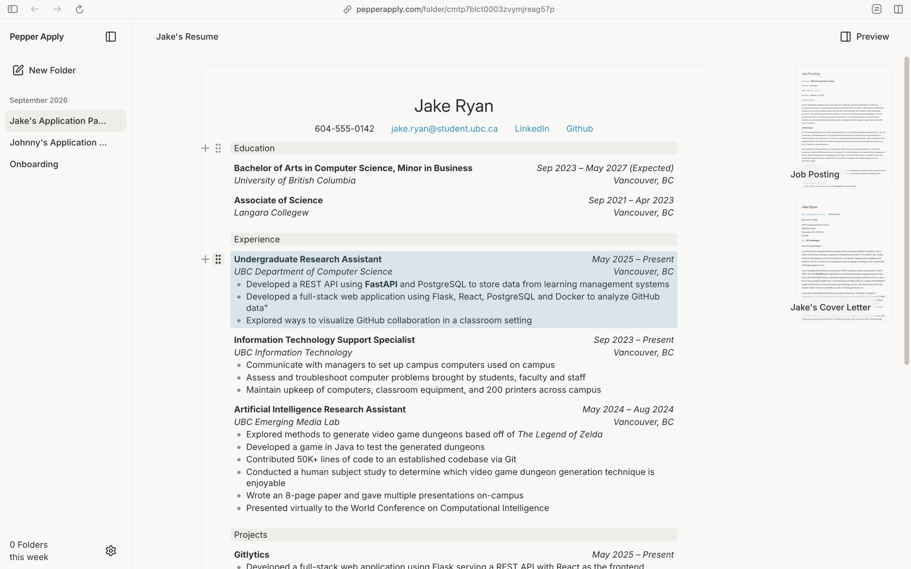
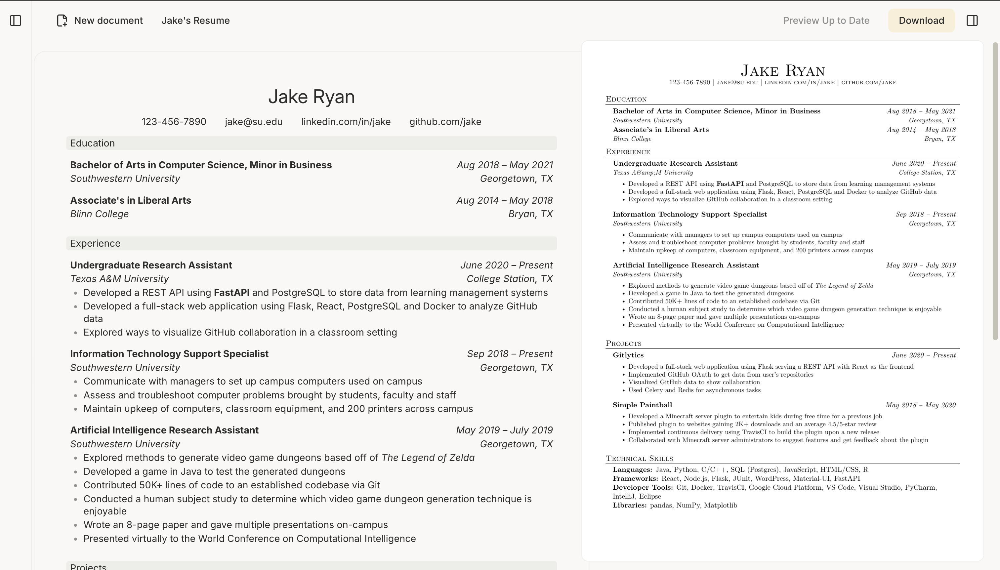

<small>one folder per application: the resume, the posting and the letter, a click apart.</small>

Pepper Docs is a TipTap based semi structured Rich-Text editor for PDF documents.

<small>drag a whole entry, or a whole section, and the PDF reflows.</small>

more info to come!

<small>side by side: what you type, and what the recruiter gets.</small>
