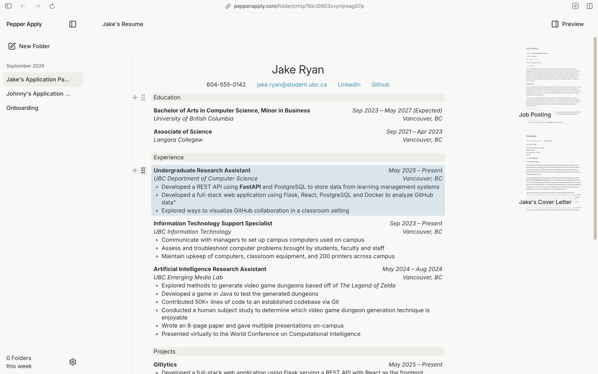
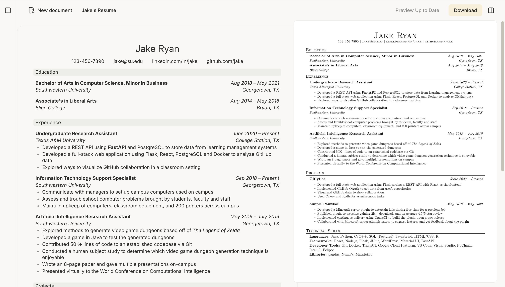

Every co-op season I'd write about forty cover letters. Each one started as a copy of the last, and each one broke a little more of the formatting. By `aug 2025` I had a folder called `final_final_v3` and I was done.

Resumes and cover letters are documents where the layout *is* part of the content. Recruiters see the PDF, not your Google Doc. But every tool I tried made me pick one: edit text comfortably and hope the PDF comes out right, or edit the PDF directly and lose your mind.

<small>drag a whole entry, or a whole section, and the PDF reflows.</small>

pepper docs treats a document as blocks, like Notion. Sections, entries, and bullets are things you can grab and move. <mark>The PDF is always the real output, never an export you check at the end.</mark> Every edit re-renders it, and the preview sits right beside you.

<small>side by side: what you type, and what the recruiter gets.</small>

Some decisions I'm happy with:
- templates are just layouts. Your content doesn't know which one it's wearing, so switching takes one click.
- one folder per application: the job posting, the resume, and the letter together.
- no AI writing for you by default. It helps with tailoring, and you hit accept.

It's live at pepperdocs.app and about a hundred people use it each week, mostly UBC students right now. If that's you, say hi. I read every piece of feedback, usually at 1am.
