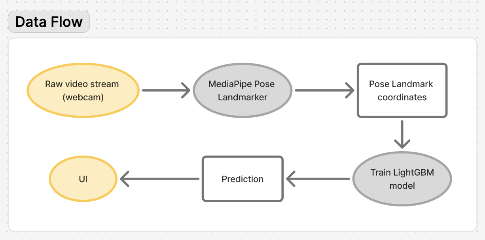
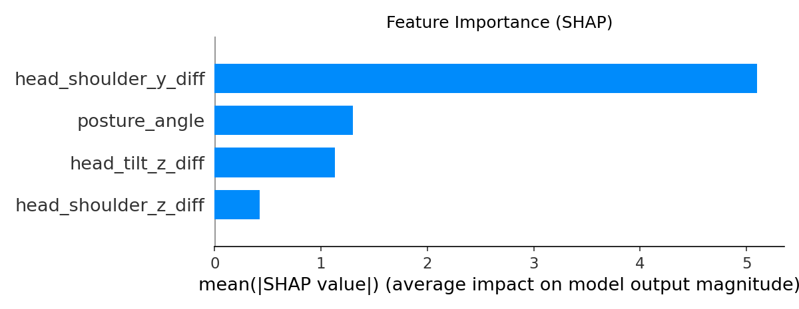
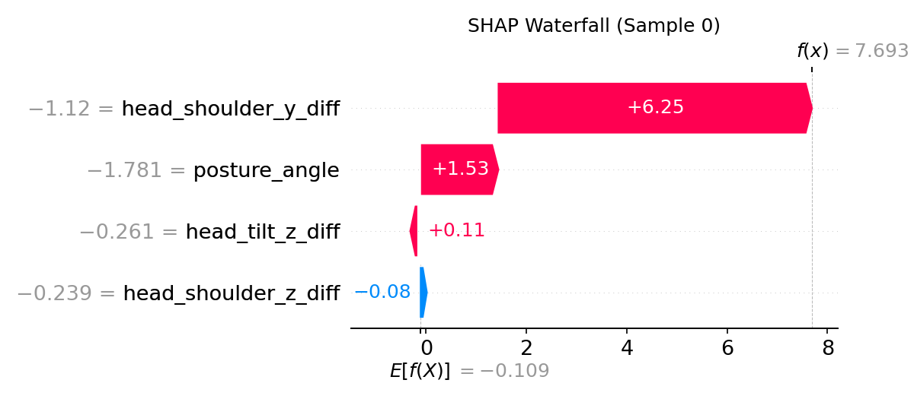

## the problem: "sit up straight!"

A small project to learn ML and help me sit up straight, using Google MediaPipe.

Traditional solutions are often clumsy wearables. I wanted a simpler and intelligent solution using my laptop's webcam. There were no existing tools like that.


## the dataset

This is my favourite part of the project. I decided to collect training data directly using the webcam, and it gives two major benefits:

1. **Personalization:** Individual users collect their own data, allowing the model to train specifically on their body type and webcam configuration.
2. **Volume:** Just look at your screen and hold the "up arrow" for "up-straight" or "down arrow" for "slouching." This makes it super easy to collect thousands of data points in minutes! If there are multiple users, it also opens the potential to combine all that data to train a robust "super model" (maybe?).

In the app's "Data Collection" mode, raw video frames are captured and immediately processed into 3D landmarks using Google’s MediaPipe. This raw data then passes through a pipeline of transformations (as shown in the figure below) before the final prediction is displayed in the UI.



## the model and approach

Rather than feeding raw pixels into a heavy Convolutional Neural Network (CNN), I used a feature-based approach.

1. **Feature Extraction**: I used [MediaPipe Pose Landmarker](https://ai.google.dev/edge/mediapipe/solutions/vision/pose_landmarker). In simple terms, this tool converts the webcam video stream into a set of 3D coordinates of distinct points (landmarks) on my body, like shoulders, ears, and nose.
   ```py
   # Feeding real-time webcam video stream to MediaPipe Pose Landmarker
   with vision.PoseLandmarker.create_from_options(options) as detector:
   		...
   		frame = cv2.flip(frame, 1)
   		rgb_frame = cv2.cvtColor(frame, cv2.COLOR_BGR2RGB)
   		mp_image = mp.Image(image_format = mp.ImageFormat.SRGB, data = rgb_frame)
   		frame_timestemp_ms = int(time.time() * 1000)
   		
   		detector.detect_async(mp_image, frame_timestemp_ms)
   
   # 3D landmarks returned by MediaPipe Pose Landmarker
   left_shoulder = np.array([p[12].x, p[12].y, p[12].z])
   right_shoulder = np.array([p[11].x, p[11].y, p[11].z])
   left_ear = np.array([p[8].x, p[8].y, p[8].z])
   right_ear = np.array([p[7].x, p[7].y, p[7].z])
   nose = np.array([p[0].x, p[0].y, p[0].z])
   mouth_left = np.array([p[10].x, p[10].y, p[10].z])
   mouth_right = np.array([p[9].x, p[9].y, p[9].z])
   ```
2. **Feature Engineering**: From the 3D landmarks, I calculated geometric features such as the `posture_angle` (angle of the neck relative to the vertical axis) and `head_shoulder_z_diff` (forward depth of head vs. shoulders). I defined five different feature sets and put them to the test!
   ```json
   FEATURE_SETS = {
       "set1": [
           'head_shoulder_z_diff',
           'head_shoulder_y_diff',
           'posture_angle',
           'head_tilt_z_diff',
       ],
       "set2": [
           'head_shoulder_z_diff',
           'head_shoulder_y_diff',
           'posture_angle',
       ],
       "set3": [
           'head_shoulder_z_diff',
           'head_shoulder_y_diff',
       ],
       "set4": [
           'posture_angle',
       ],
       "set5": [
           'head_shoulder_z_diff',
           'head_shoulder_y_diff',
       ]
   }
   ```
3. **Classification**: I used the [LightGBM](https://lightgbm.readthedocs.io/en/stable/) classifier (a gradient-boosting framework that is fast and effective for tabular data), and carried out hyperparameter optimization using `GridSearchCV` with 3-fold cross-validation on each feature set. Essentially, this process is meant to locate the best parameters for the model, and to find the best-performing combination of features. This ensures the final model is as accurate as possible!
   ```py
   for set_name, feature_columns in FEATURE_SETS.items():
   		X_train_subset = X_train[feature_columns]
       X_test_subset = X_test[feature_columns]
       
   		base_model = lgb.LGBMClassifier(objective='binary', verbosity=-1)
   		grid_search = GridSearchCV(
   		    estimator=base_model,
   		    param_grid=param_grid,
   		    cv=3,
   		    n_jobs=-1,
   		    scoring='accuracy'
   		)
   		
   		grid_search.fit(X_train_subset, y_train)
   		
   		model = grid_search.best_estimator_
   		best_params = grid_search.best_params_
   ```

The diagram below depicts the possible states of the app. The inferencing state is where the user receives real-time posture predictions. They could also choose to train and save a new model at any time, which is auto-loaded upon next launch.


## results

With a balanced dataset of 613 samples (313 "Slouching" and 300 "Up Straight"), the results were surprisingly good.

Set 1 (using all available features) was the clear winner (highest validation score), while Set 4 (relying solely on neck angle) performed significantly worse. The model correctly identifies my posture most of the time.

```txt
Training: 613 samples (slouching=313, upright=300)
set1: train=1.0000, validation=0.9224
set2: train=0.9388, validation=0.9081
set3: train=0.9306, validation=0.9061
set4: train=0.8633, validation=0.8326
set5: train=0.9306, validation=0.9061
Best: set1 (validation=0.9224, test=0.9431)
Switching to INFERENCING mode with the best model
```

To understand how the model makes decisions, I used SHAP to explain feature influence. `head_shoulder_y_diff` dominated - lower values indicate higher slouching probability.

This reveals that "sitting up tall" is literally about height. When you slouch, your head drops vertically relative to your shoulders. The model picked up on this vertical compression as the strongest signal, with neck angle being a distant second.

SHAP Box Plot:



SHAP Waterfall Plot (for a specific example in data):



## caveats: future improvements

1. **Potential Overfitting:**

   The model achieved perfect training accuracy (100%), and a 7.76% gap between training and validation (92.24%) scores. With only ~490 training samples and using LightGBM, it likely memorized the training data a bit too much, which makes it hard to generalize. Further hyperparameter tuning might be necessary.
2. **Single-Subject Bias (Overfitting to "Me")**:
   The model was trained entirely on me (or whoever the user is). If a taller person sat down, the geometric feature thresholds (like `head_shoulder_z_diff`) might completely fail. The model currently lacks generalization.
3. **Positional Dependency**:
   Although I normalized features by shoulder width, simple geometry isn't immune to perspective distortion. The model has learned my specific setup - my webcam angle and typical sitting distance. This means it might be learning "distance from camera" rather than "curvature of spine." A slouch up close could look like an upright posture farther away. To fix this, I need more diverse training data: different camera angles, distances, and slouching intensities. Otherwise, the model stays tuned to my exact setup rather than understanding posture itself.
