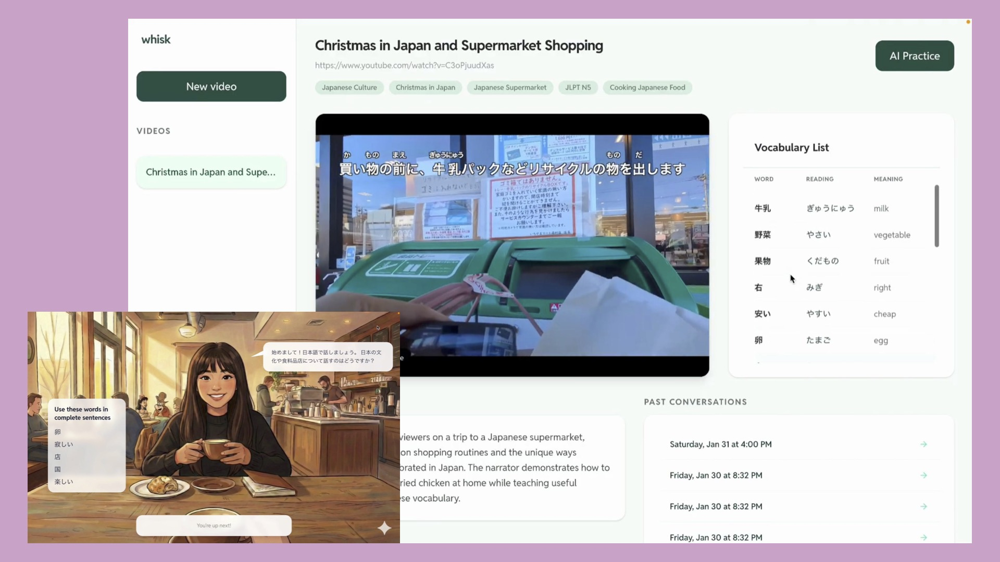
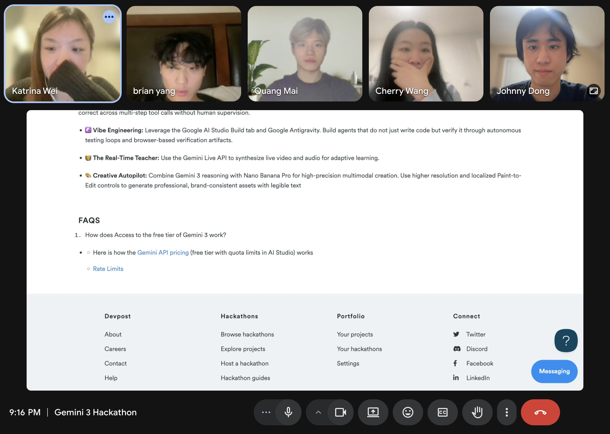
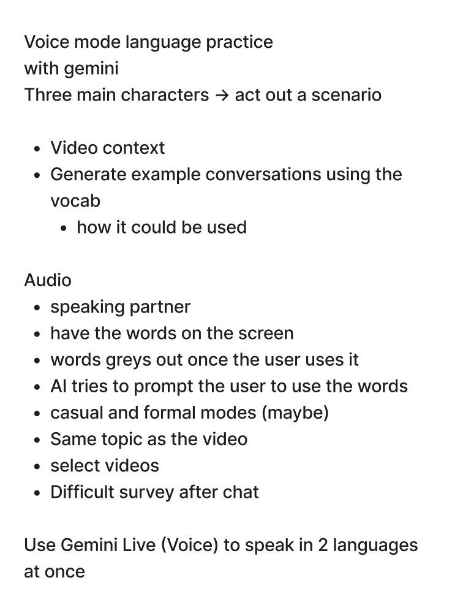
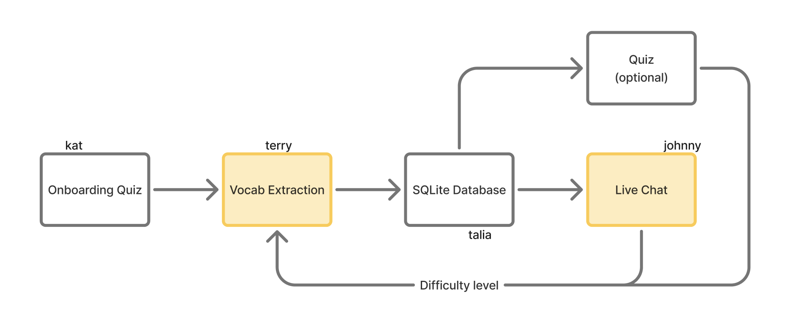
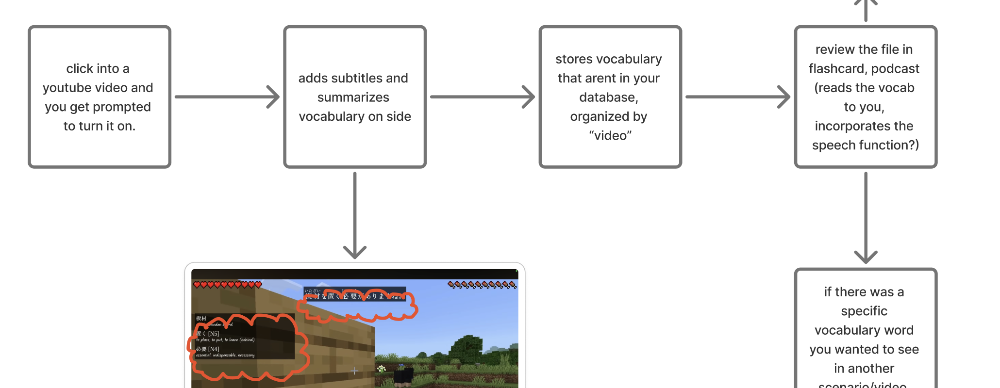
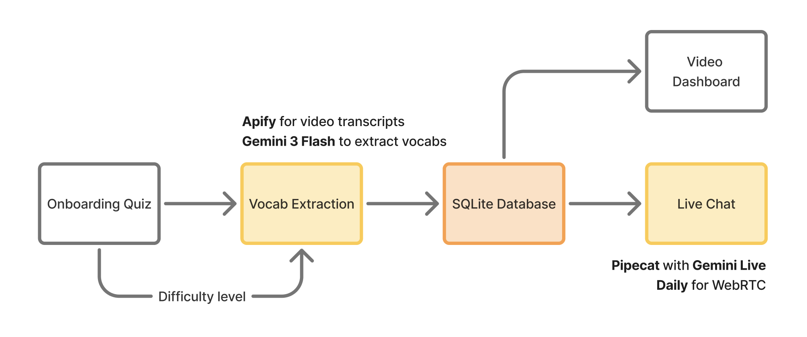
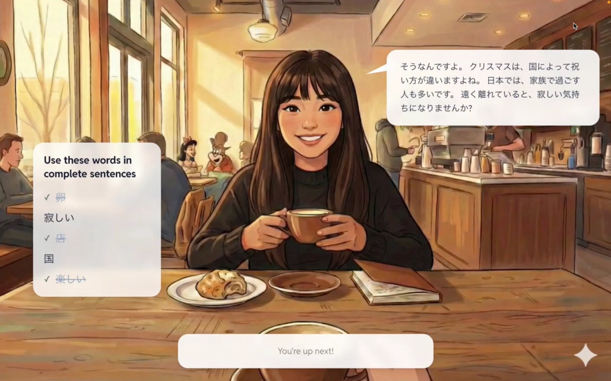

[watch the demo](https://youtu.be/ehOObTde4LM?si=8GoAFnVaubaGwjVb)

## I lead a hackathon team

I joined the Gemini hackathon with some friends from UX Hub and found out I was the only developer on a team of designers. We pulled in more devs from UBC LunchPad, but suddenly everyone looked to me to lead. I took on the challenge.

## brainstorming



Designing an app like this feels magical, like abstract shapes sharpening into something real. As the UX took shape on FigJam, I scoped our project components and assigned each developer a portion of the prototype.





Prototyping early paid off. We swapped Notion/Anki APIs for SQLite. The Gemini Live API had echos, so we replaced it with Pipecat.

## building

```txt
frontend/
app/
├── (conversation)/
│   └── conversations/
│       └── [conversationId]/
├── (dashboard)/
│   ├── dashboard/
│   └── videos/
│       ├── [videoId]/
│       └── new/
├── (onboarding)/
└── api/
    └── ...
```

The hardest part of a 7-person team was collaboration. I set up the repo structure early so people wouldn't step on each other. The frontend split into three feature groups using Next.js route groups 👆

I primarily worked on the live chat feature, but also helped out wherever I could. I felt like I had to hold everything together - but the app was complex and feature-rich, and there was no way I could handle it all alone.





## deploying

A core feature of the app was extracting vocab from YouTube videos. Hours before the deadline, the YouTube Transcript API stopped working. Turns out YouTube actively blocks third-party APIs.

We scrambled through residential proxies before landing on an [Apify Actor](https://apify.com/topaz_sharingan/youtube-transcript-scraper) (a managed scraping service). It worked!


## reflection

This is my first time leading a hackathon team, and I learned a lot.

I feel like I had a tendency to want to control every detail, but the team actually did its best work when I stepped back and trusted people with their slices. Quang and Cherry designed the voice chat UI; Terry and Kat built the video dashboard. Those turned out to be some of the best parts of the app - things I could never have built on my own.

Three weeks of running online meetings, talking in the group chat, and contributing to features. For most of it I was quietly worried the project could fall apart. But here we are! We built something in three weeks that we’re truly proud of.
