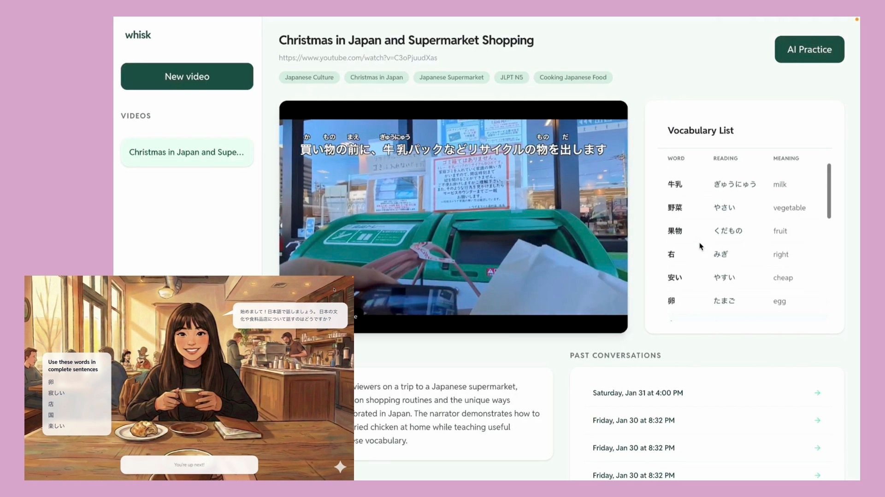

hello
I've been learning Japanese since 2024, and speaking is the one skill that hasn't improved. Flashcards taught me to recognize 牛乳 on a carton. They didn't teach me to ask someone where the milk was.

whisk is what four of us built between `jan 10` and `feb 21`. You paste a YouTube video you actually want to watch. It pulls the transcript, builds a vocabulary list with readings, and then puts you in a café with someone who wants to talk about it. In Japanese, out loud.

<small>left: the practice scene. right: a video's vocabulary list and past conversations.</small>

The idea we kept coming back to was ==the screen should react to what you say, not what you click.== When you use a word from the list, it gets checked off. When you go quiet for a few seconds, a hint panel slides in with the words you haven't used yet. When you switch to English, the character waits for you to come back. She doesn't correct you.

What I worked on:

- the realtime loop: mic → transcript → model → UI events, in under a second most of the time
- tool calls that let the model move the interface (`show_hints`, `check_word`, `end_scene`) instead of only replying with text
- the vocabulary extractor, which turned out to be mostly about deciding what _not_ to show

`@mina` did the illustrations and most of the scene design. `@daniel` and `@sora` built the video pipeline and the conversation history. We demoed on `feb 21` and the first question we got was "can I use this tonight." That was the best feedback we got.

Things I'd change:

- latency matters more than accuracy. A slightly wrong reply in 600ms feels like a conversation. A perfect one in 3s feels like a form.
- we spent a week on a scoring system nobody looked at. Nobody wants a grade from a friend.

I still use it a few nights a week, mostly with cooking videos.
